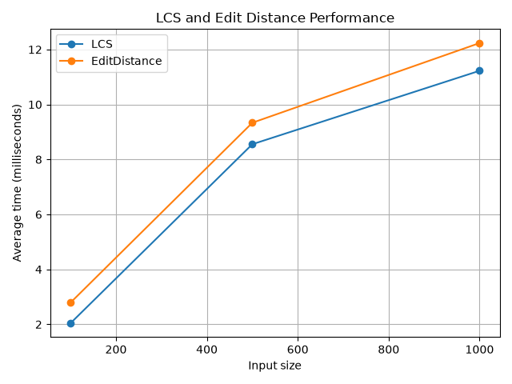
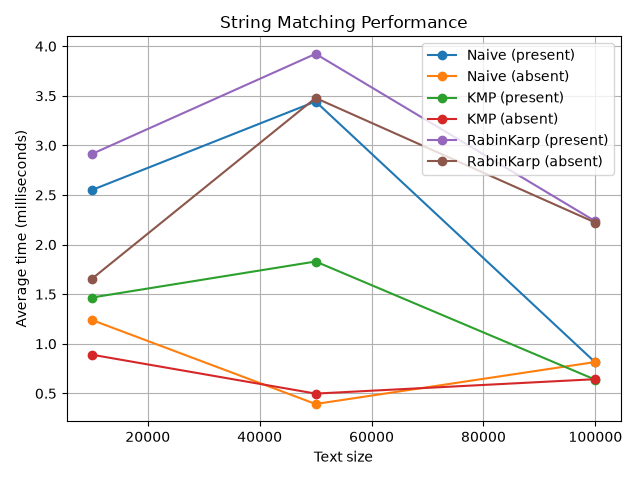
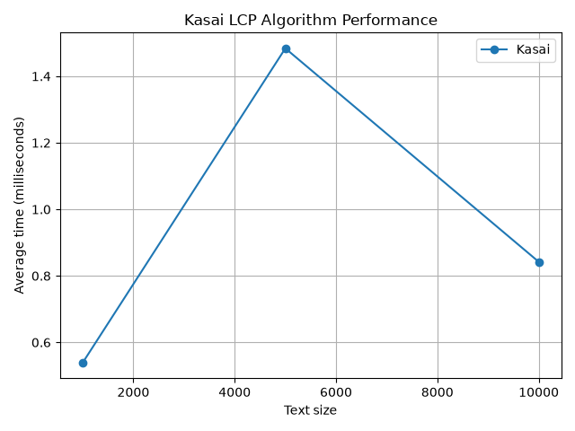

# Assignment 4: Text Analysis

## 1. Project Overview

The goal of this assignment is to implement, test, and compare algorithms for text analysis. The project covers dynamic programming, string matching, and suffix-array processing.

The project includes:

- Longest Common Subsequence (LCS).
- Levenshtein Edit Distance.
- Naive String Search.
- Knuth-Morris-Pratt (KMP).
- Rabin-Karp.
- Kasai algorithm for building the Longest Common Prefix (LCP) array.
- Benchmark experiments and performance graphs.

The algorithms are implemented in Java. JUnit tests are used to check their correctness. Benchmark results are saved as CSV files, and a Python script generates graphs from these results.

## 2. Implementation and Decisions

### Longest Common Subsequence (LCS)

- LCS is implemented using dynamic programming.
- A two-dimensional table stores the LCS length for prefixes of the two input strings.
- If the current characters are equal, the value is the diagonal cell plus one.
- Otherwise, the algorithm takes the maximum of the cell above and the cell on the left.
- The last table cell contains the length of the longest common subsequence.

### Levenshtein Edit Distance

- Edit Distance uses dynamic programming to calculate the minimum number of operations needed to transform one string into another.
- The allowed operations are insertion, deletion, and substitution.
- The first row and column represent transformations involving an empty string.
- If two current characters are equal, no additional operation is required.
- Otherwise, the algorithm chooses the minimum cost among insertion, deletion, and substitution.

### Naive String Search

- The algorithm checks every possible starting position in the text.
- It compares the pattern characters with the corresponding text characters.
- Every position where the full pattern matches is added to the result.
- This algorithm is simple, but it may repeat many character comparisons.

### Knuth-Morris-Pratt (KMP)

- KMP uses an LPS array during searching.
- LPS means Longest Proper Prefix which is also a Suffix.
- The LPS array is calculated before the search starts.
- When a mismatch occurs, the array helps determine how far the pattern can move without repeating unnecessary comparisons.
- This improves the worst-case running time compared with the naive approach.

### Rabin-Karp

- Rabin-Karp compares the hash of the pattern with the hash of each text window.
- A rolling hash updates the window hash when the window moves by one character.
- The implementation uses base 31 and modulus 1,000,000,007.
- When the hashes match, the algorithm compares the actual characters to confirm a match.
- This verification is necessary because different strings can have the same hash value.

### Kasai Algorithm

- Kasai builds an LCP array from a string and its suffix array.
- LCP means Longest Common Prefix.
- Each LCP value represents the common-prefix length of two neighbouring suffixes in suffix-array order.
- The algorithm first builds a rank array that records the position of each suffix in the suffix array.
- It reuses information from previous comparisons to avoid starting every comparison from zero.
- The suffix array is constructed separately before the Kasai benchmark starts.

### Suffix Array Construction

- The project includes a simple suffix-array construction method.
- It uses prefix doubling and rank values to sort suffixes.
- In each iteration, the algorithm compares ranks for increasingly longer prefixes.
- The suffix-array construction is used to prepare input for Kasai and is not included in the Kasai timing measurements.
- The implemented prefix-doubling approach uses sorting in each iteration, giving an approximate time complexity of O(n log² n).

### Empty Pattern Behaviour

- In the current implementation, searching for an empty pattern returns the position 0.
- This behaviour is checked by the string-matching tests.
- Naive Search, KMP, and Rabin-Karp use the same behaviour so that their results remain consistent.

## 3. Time and Space Complexity

Here, n is the text length and m is the pattern length. For LCS and Edit Distance, n and m are the lengths of the two input strings. For string matching, n is the text length and m is the pattern length.

The space complexity of string-matching algorithms excludes the list of returned match positions, which can require O(k) space for k matches.

### LCS

- Time complexity: O(nm).
- Auxiliary space: O(nm).
- The algorithm fills a two-dimensional table with values for pairs of prefixes.

### Edit Distance

- Time complexity: O(nm).
- Auxiliary space: O(nm).
- Each table cell is calculated using a constant number of operations.

### Naive String Search

- Best-case time complexity: O(n), for example when comparisons fail immediately at most positions.
- Worst-case time complexity: O(nm).
- Auxiliary space: O(1), excluding the output list.
- In the worst case, the algorithm compares many characters at each possible starting position.

### KMP

- Preprocessing time: O(m).
- Search time: O(n).
- Total time complexity: O(n + m).
- Auxiliary space: O(m), excluding the output list.
- The LPS array prevents unnecessary repeated comparisons.

### Rabin-Karp

- Expected time complexity: O(n + m), assuming hash matches and character verification remain limited.
- Worst-case time complexity: O(nm), when many windows have matching hashes and require character-by-character verification.
- Auxiliary space: O(1), excluding the output list.
- The rolling hash allows the hash of the next window to be calculated efficiently.

### Kasai

- Time complexity: O(n), when the suffix array is already available.
- Auxiliary space: O(n).
- The algorithm uses rank and LCP arrays and reuses information from previous comparisons.

### Suffix Array Construction

- Approximate time complexity: O(n log² n) for the prefix-doubling implementation that sorts suffix ranks in each iteration.
- Auxiliary space: O(n), excluding implementation overhead from sorting objects.
- This construction is separate from the Kasai benchmark.

## 4. Testing

JUnit tests are included for the main algorithms and important edge cases.

### LCS Tests

- Identical strings.
- Completely different strings.
- An empty string.
- A standard example with a known LCS length.

### Edit Distance Tests

- Identical strings.
- An empty string.
- Character substitution.
- Character insertion.
- Character deletion.

### String Matching Tests

- A match at the beginning of the text.
- A match in the middle.
- A match at the end.
- Multiple occurrences.
- A pattern that is absent.
- A pattern longer than the text.
- An empty pattern.

The tests check that Naive Search, KMP, and Rabin-Karp return the same expected positions for the same input.

### Kasai Tests

- A short string with a known suffix array.
- A second short example with a known LCP array.
- Comparison of the calculated LCP values with expected values.

The tests can be run through the Maven test lifecycle in IntelliJ IDEA.

## 5. Experimental Setup

The experiments use randomly generated strings with a fixed random seed of 42. The alphabet for generated strings is:

abcdefghijklmnopqrstuvwxyz

The tested input sizes are:

- LCS and Edit Distance: 100, 500, and 1,000 characters for each input string.
- String matching: text lengths of 10,000, 50,000, and 100,000 characters.
- Kasai: string lengths of 1,000, 5,000, and 10,000 characters.

### String Matching Experiments

- Both present and absent patterns are tested.
- The same text and pattern are used for Naive Search, KMP, and Rabin-Karp within each comparison.
- The present pattern is selected from the middle of the generated text.
- The absent pattern contains `{` characters, which are outside the generated lowercase alphabet.
- The pattern length is 20 characters.

### Timing Method

- Execution time is measured with `System.nanoTime()`.
- LCS and Edit Distance use three warm-up runs followed by five measured runs.
- String-matching and Kasai experiments currently use five measured runs.
- The average time is calculated from the measured runs.
- Input generation and CSV file writing are outside the measured algorithm time.
- For KMP and Rabin-Karp, the measured search call includes preprocessing performed inside the search method.
- For Kasai, suffix-array construction is completed before timing the LCP calculation.
- The string-matching CSV results include average character-comparison and hash-comparison counters where implemented.

Java execution time can be affected by JVM optimisation, garbage collection, and other running processes. The benchmark results should therefore be interpreted as measurements from a particular environment rather than exact theoretical running times.

## 6. Experimental Results and Graphs

The benchmark program creates the following CSV files:

- results/lcs_edit_distance.csv
- results/string_matching.csv
- results/kasai.csv

The Python plotting script reads these files and generates three graphs.

### LCS and Edit Distance

This graph compares the average execution time of LCS and Edit Distance for different input sizes.

Both algorithms use dynamic programming and have O(nm) time complexity. Their execution times are expected to increase as the input strings become longer because more table cells must be processed.

### String Matching

This graph compares Naive Search, KMP, and Rabin-Karp for different text lengths and for both present and absent patterns.

Naive Search may repeat many character comparisons. KMP uses the LPS array to avoid unnecessary repeated comparisons. Rabin-Karp uses rolling hashes and verifies characters when hash values match.

The actual running times depend on the input data, implementation details, and the computer used for the experiment.

### Kasai Algorithm

This graph shows the average execution time of Kasai for different string lengths.

Kasai has O(n) time complexity when the suffix array is already available. Suffix-array construction is excluded from the measured Kasai execution time.

The graphs are generated from the CSV results. They should be regenerated after running the benchmarks again.

## 7. Theoretical and Experimental Comparison

Theoretical complexity explains how algorithms should scale as inputs grow. Experiments show how they behave on actual generated inputs.

- LCS and Edit Distance both use dynamic programming tables, so their running times increase with the product of the input lengths.
- Naive Search is easy to implement but can repeat many character comparisons.
- KMP uses the LPS array to avoid unnecessary repeated comparisons and has O(n + m) total time complexity.
- Rabin-Karp updates the hash as the text window moves, but hash matches still require character verification.
- Kasai constructs the LCP array in linear time when the suffix array is already available.
- Suffix-array construction is a separate operation and is not included in the Kasai timing measurements.

The measured results may not increase perfectly with each input size. JVM optimisation, garbage collection, and other processes can affect individual measurements. The graphs should be considered experimental evidence and compared with the theoretical complexity of each algorithm.

## 8. Conclusion

In this assignment, I implemented and tested dynamic programming algorithms, three string-matching algorithms, and the Kasai algorithm.

LCS and Edit Distance solve their problems by storing intermediate results in tables. Naive Search is straightforward but can repeat comparisons. KMP improves searching by using the LPS array, while Rabin-Karp uses rolling hashes and verifies possible matches. Kasai efficiently builds the LCP array when the suffix array is available.

The benchmark experiments provide a practical comparison of algorithm performance at different input sizes. They also show why theoretical complexity and measured execution time should be considered together.

Each algorithm has its own advantages, and the best choice depends on the input data and the requirements of the problem.

## 9. How to Run

1. Open the project in IntelliJ IDEA.
2. Reload the Maven project.
3. Run the Maven test lifecycle.
4. Run textanalysis.Main with the program argument benchmark.
5. From the project root, run python scripts/plot_results.py.
6. Check that the CSV files and PNG graphs have been created in the results directory.

The results directory should contain the benchmark CSV files and the generated graphs. The graphs are referenced directly in this README so they can also be displayed when viewing the project on GitHub.
